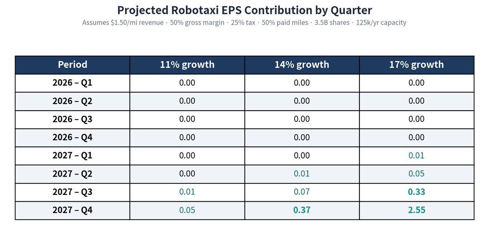
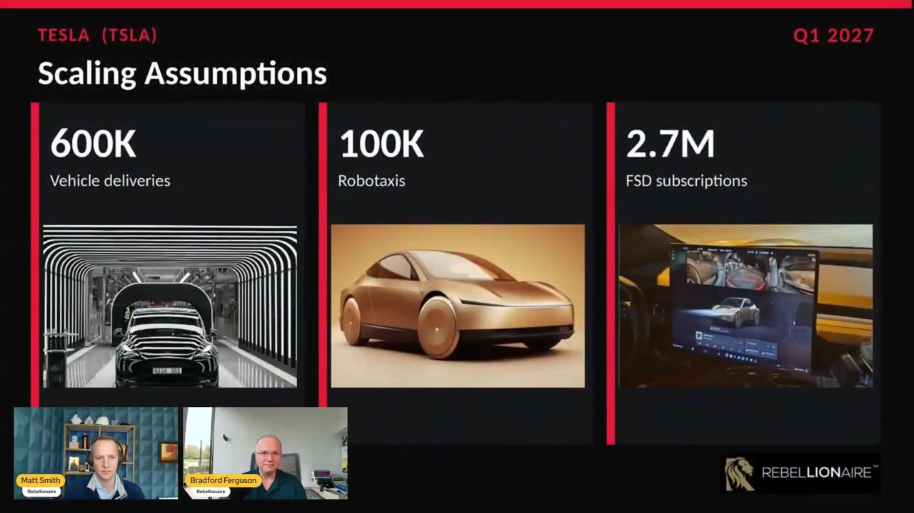
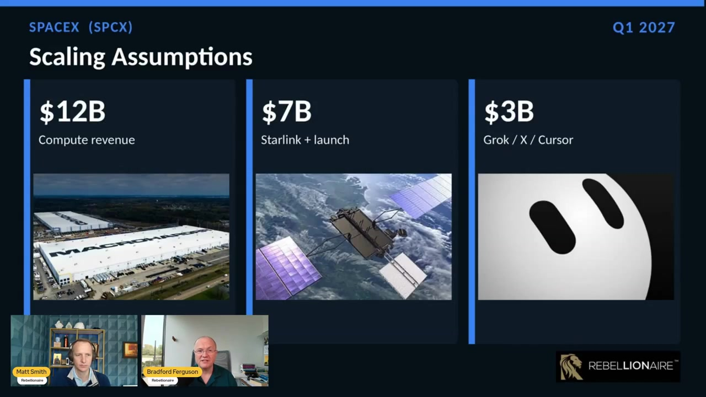
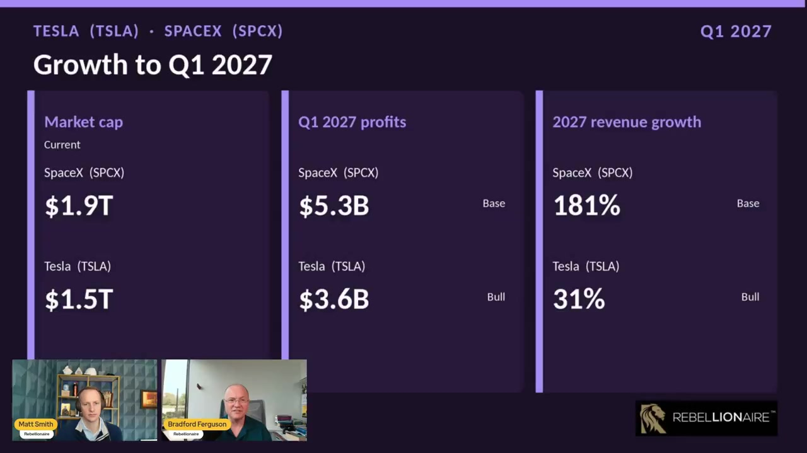
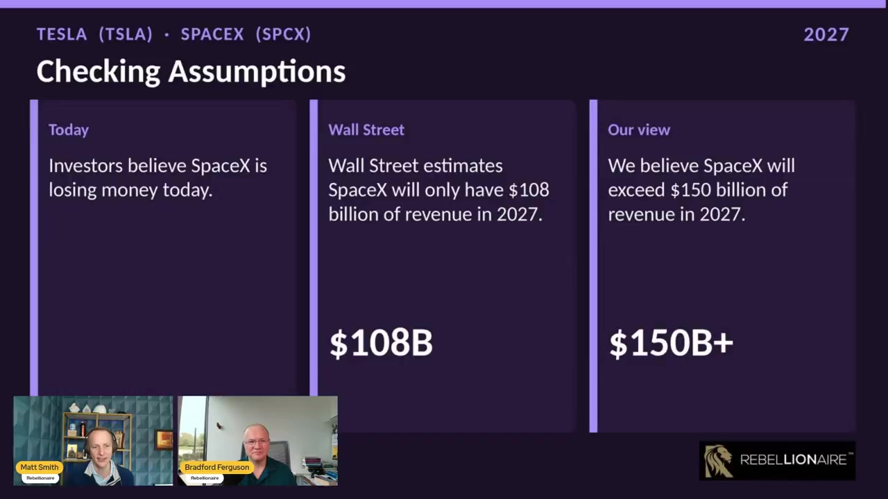
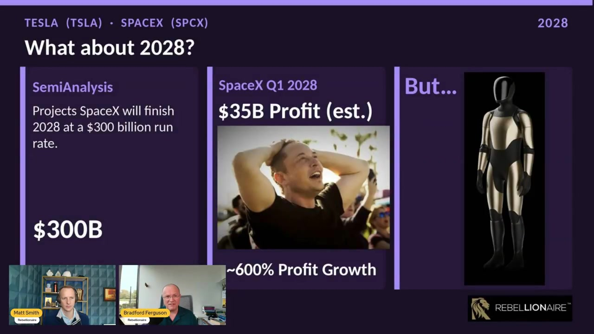

# TSLA vs SPCX 输入整理与查证

> 状态：第一轮。只整理、转写、拆推导、核验公开数据。完整估值模型和风险折价后的仓位比较留到下一轮。
>
> 基准日：2026-09-26（视频录于 2026-09-25）。价格取 2026-09-25 收盘。

## 0. 要回答的问题

长期 TSLA 持有者想比较：**在风险折价后，$TSLA 和 $SPCX 谁的期望回报更高。**

本轮只做输入层：

1. 把两份核心材料里的数字、假设、推导逻辑拆干净。
2. 用公司文件和可独立复核的公开数据查证。
3. 标出已经能确认、存疑、以及下一轮建模必须处理的矛盾。

两份输入：

| 材料 | 作者 | 时间 | 核心主张 |
| --- | --- | --- | --- |
| X Article *From a Whisper to a Wave* | [@nymbusjp](https://x.com/nymbusjp/status/2080254118472388863)（Genma_Jp） | 2026-07-23，Q2 电话会次日 | Robotaxi unsupervised miles 在以双位数周复合增长；2026 几乎没有 EPS，2027 中后段才拐点 |
| 视频 *SpaceX vs Tesla Growth Expectations* | [@Rebellionaire](https://x.com/Rebellionaire/status/2103575186674978962)（Matt Smith / Bradford Ferguson） | 2026-09-25 | 用 **Tesla 牛市假设 vs SpaceX 基准假设**，Q1 2027 SpaceX 利润约 1.5× Tesla，收入增速约 6×；这改变了他们对并购时点的看法 |

补充：Cybercab 发布会上 Ashok 给出的 **100 万** unsupervised miles（不是 1 亿），被 nymbusjp 用来确认 **17% 周增长率**。中文语境里「100M miles」通常对应 100 万英里。公开记录是 **1 million miles**。[^electrek-1m][^teslarati-1m]

---

## 1. 市场快照（查证用，不是结论）

| | Tesla (`TSLA`) | SpaceX (`SPCX`) |
| --- | --- | --- |
| 2026-09-25 收盘 | $372.11 [^tsla-px] | $148.68 [^spcx-px] |
| 市值 | 约 $1.47–1.50T [^tsla-px] | 约 $2.01–2.02T [^spcx-px] |
| Rebellionaire 视频里用的市值 | $1.5T | $1.9T |
| 最近完整季度 | Q2 2026（截至 6/30） | Q2 2026（截至 6/30） |
| 当季收入 | $28.236B（+26% YoY）[^tesla-q2] | $7.814B（+92% YoY）[^spacex-q2] |
| 当季 GAAP 净利 | $1.114B；稀释 EPS $0.32 [^tesla-q2] | **亏损** $541M；EPS −$0.09 [^spacex-q2] |
| 当季经营利润 | $398M（利润率 1.4%）[^tesla-q2] | −$143M [^spacex-q2] |
| 毛利率 | 16.8% [^tesla-q2] | 约 55.3%（由收入/成本倒推）[^spacex-q2] |
| TTM GAAP PE | 约 340–390×（MarketBeat 报 344.6×）[^tsla-px] | 不适用（仍亏损） |
| 稀释股本（粗算） | Q2 净利 $1.114B / EPS $0.32 ≈ **34.8 亿股** | Q2 加权平均 58.64 亿股；IPO 后 fully diluted 口径各源不一致（约 81–136 亿）[^spacex-q2][^spcx-px] |

Rebellionaire 视频里的「现在市值差不多、SpaceX 略高」方向对，但他们用的 $1.9T vs $1.5T 已经略旧：到 9/25，SPCX 更接近 $2.0T，TSLA 仍约 $1.5T。

---

## 2. 材料 A — nymbusjp：《From a Whisper to a Wave》

**原文：** X Article，2026-07-23 11:30 UTC，标题 *From a Whisper to a Wave: Robotaxi’s Real Trajectory*。[来源帖](https://x.com/nymbusjp/status/2080254118472388863)

作者事先声明：文章里的 EPS 是「到该 period 的累计 Robotaxi EPS 贡献，不是当季」。表格标题写的是 *Projected Robotaxi EPS Contribution by Quarter*，两种读法在第 2.5 节处理。

### 2.1 文章在说什么

社区抱怨 Robotaxi 没有可见的 scaling 计划。Elon 承诺过 epic 2026 / ridiculous 2027。作者认为 2026 已经 miss。但 Q2 电话会上 Ashok 第一次给了可计算的数字，于是用几何级数把「双位数周增长」外推到 2027 年底。

结论：2026 财务上几乎为零；指数曲线在 **2027 夏末** 才开始在利润里看得见，2028 才可能「ridiculous」。

### 2.2 公司原话（这是整篇文章的锚）

Ashok Elluswamy，Tesla Q2 2026 电话会（2026-07-22）：[^ashok-call]

> We have driven more than 380,000 miles of unsupervised Robotaxi, now across six cities in two different states. We have had zero notable incidents.
>
> Since the beginning of this year, we have grown at **double-digit growth rates** to the number of unsupervised miles that the fleet drives every week. … We expect to continue growing at such a large rate through the rest of this year.
>
> We have aligned our manufacturing targets to roughly match the projected growth rate of the unsupervised miles.

Elon 在同一场电话会上把周增长说成 **more than 10%**。[^bi-7numbers]

股东信补充：[^tesla-q2]

- 累计 **paid** Robotaxi miles 到 6 月底约 **250 万**（图到 2.5M 刻度）。
- Cybercab 德州产线已投产，标注产能 **>125,000 辆/年**。
- 七个 metro：Austin / Dallas / Houston / Miami / Orlando / Tampa 为 unsupervised ramping；湾区仍是 safety driver。

**查证：这三句话是真的。** 380,000、double-digit WoW、>125k Cybercab 产能都能在电话会和 Q2 Update 对上。

「zero notable incidents」是公司口径。Electrek / TeslAnt 指出 NHTSA/州文件里到 5 月至少有 17 起被记录事件，定义与「notable / at-fault」不是一回事。[^electrek-1m] 建模时应把安全记录当**公司自称**，不当独立审计结论。

### 2.3 作者怎么把「double-digit」变成 11 / 14 / 17%

| 情景 | 周增长率 | 作者理由 |
| --- | --- | --- |
| 悲观 | 11% | 「double-digit」下限 |
| 基准 | 14–15% | 「中枢」 |
| 乐观 | 17% | 「再高，用词就不会只是 double-digit」 |

起点：2026 年第 1 个日历周。作者认为 2025 年底只是 handful of rides。

累计公式（文中公式图）：

\[
S_k = m_1 \cdot \frac{r^k - 1}{r - 1},\quad r = 1 + x/100
\]

用 \(S_{30} = 380{,}000\) 反解 \(m_1\)，再还原每周 miles。

**推导本身是标准几何级数，数学正确。** 独立复核 17% 情景：

- \(m_1 \approx 587\) miles
- 第 30 周当周 miles ≈ 55,700
- 2026 年末（第 52 周）当周 miles ≈ 176 万
- 按 100 miles/车/天 → 约 **2,517 辆**，与原文图上的 2,517 一致

三个需要单独标注的假设：

1. **增长率从 CW1 起就是常数。** Ashok 说的是「年初以来双位数」，不是「每周精确同一数字」。早期基数极小，任意一个起步周的选择都会改 \(m_1\)。
2. **「double-digit」被收成 11–17%。** 20% 也是 double-digit。上限 17% 是作者的语义判断，不是公司指引。
3. **只外推 unsupervised miles，不是 paid miles。** Q2 股东信的累计 paid miles 曲线在季末变平；多家独立拆图认为 Q2 paid miles 环比大约 −36%（约 110 万 → 70 万）。[^avms] 作者模型不处理这个分叉。

### 2.4 用地上车队做一致性检验

作者用当时还在更新的 Robotaxi tracker：

- CW4：2 辆 unsupervised
- CW19：38 辆 unsupervised
- 横线：到 7 月中德州 DMV 登记约 **102 辆**

反推日均里程：

| | 11% | 14% | 17% |
| --- | --- | --- | --- |
| 用 CW4 | 187 | 113 | 67 |
| 用 CW19 | 47 | 42 | 37 |

作者取 **50 miles/车/天** 作为当前阶段工作假设，并画了「50 miles/天隐含车队」图：三条曲线都在 CW30 / 7 月中附近穿过 102 辆那条线。这是文章里最有价值的交叉检验——增长率、累计 miles 和登记车队三者没有明显打架。

随后把年末利用率改成 **100 miles/车/天**，得到 2026 年末 unsupervised 车队：

| 周增长 | 2026 年末车队（图注） |
| --- | --- |
| 11% | 559 |
| 14% | 1,215 |
| 17% | 2,517 |

作者文字取整为 560 / 1,200 / 2,500，并说「最可能在 1,000 辆附近」。**图上的 2,517 可独立复现。** Tracker 的 2 / 38 和 DMV 102 无法从公司文件复核，只能当社区观察值。

Cybercab 产能检验：作者改用 **200 miles/车/天**（成熟 robotaxi 上限附近），问每周要加多少车才能维持该增长率，并设定产线上限 = 125,000 / 52 ≈ **2,400 辆/周**。

图注：

- 17% 在 **CW69**（约 2027 年 4 月）顶到产能
- 14% 在 **CW79**（约 2027 年 7 月）
- 11% 在 **CW95**（约 2027 年 9 月）

作者的评价：投产约 18 个月内接近满产，算「规划合理」。短端数字难看，是因为指数曲线还在底部。

**125k/年 → 2,400/周：对。** 满产时点是模型输出，不是公司指引。Tesla 也说过制造目标会去**匹配** unsupervised miles 的预计增速，并没有承诺 17% 一直维持到满产。

### 2.5 从 miles 到 EPS

转换假设：

| 假设 | 数值 | 作者依据 | 查证 |
| --- | --- | --- | --- |
| 付费占比 | 50% unsupervised miles | 空驶、充电、调度 | 公司未披露；robotaxi 行业空驶率常见 30–50%，方向合理但不可证 |
| 每付费英里收入 | $1.50 | 「tracker 观察到的当前定价」 | 2026 年 3 月 Austin 快照是 **$3 base + $1.40/mile**；短途有效单价高于 $1.50，长途接近 $1.40。Cybercab 同路线曾比 Model Y 便宜约 35%（例：$7.77 vs $12.10），高需求时又会超过 Model Y。[^fare] **$1.50 是合理的粗平均，不是稳定价目表。** |
| 毛利率 | 50% | 未论证 | Tesla 整体毛利率 Q2 只有 16.8%。Robotaxi 去掉司机后毛利可以高很多，但 50% 仍是假设 |
| 税率 | 25% | 法定税率附近 | 可接受的简化 |
| 稀释股本 | 35 亿 | 约数 | Q2：$1.114B / $0.32 ≈ **34.81 亿股**。足够近 |
| 产能 | 12.5 万/年 | Q2 deck | 已确认 |

EPS 表（原文图）：



| Period | 11% | 14% | 17% |
| --- | --- | --- | --- |
| 2026 Q1–Q4 | 0.00 | 0.00 | 0.00 |
| 2027 Q1 | 0.00 | 0.00 | 0.01 |
| 2027 Q2 | 0.00 | 0.01 | 0.05 |
| 2027 Q3 | 0.01 | 0.07 | 0.33 |
| 2027 Q4 | 0.05 | 0.37 | **2.55** |

作者文字：Tesla 近几季 EPS 在 low-to-mid $0.30s（Q2 GAAP $0.32、non-GAAP $0.33，对）。因此：

- 2026 即使乐观全年也远不到 1 分钱。
- 拐点在 2027 年中。高增长情景下 2027 Q4 已经「大」。

这与 Elon 此前「2026 不是有意义的收入年、下一年才是」的说法同方向。

#### EPS 是当季还是累计？

你的说明：表内是**累计到该 period** 的 Robotaxi EPS，不是当季。

需要并存的反证：

- 17% 情景 Q4 / Q3 = 2.55 / 0.33 = **7.73×**，而 \(1.17^{13} \approx 7.99\)。这更像**当季**贡献按周复合 13 周。
- 表题是 *by Quarter*。
- 更关键：作者同时画了**产能封顶**的周 miles 图，2027 年末约 1.4 亿 miles/周。若用同一套 50% paid / $1.50 / 50% GM / 25% tax / 35 亿股，**封顶后的 2027 Q4 当季 EPS 大约只有 $0.12**，到不了 2.55。

反过来说，$2.55 能对上的是：**17% 一直不封顶外推到 2027 Q4**。那意味着当季约 24–32 亿 unsupervised miles/周，远超 12.5 万/年产线能支撑的车队。

**建模含义：** 表上的 $2.55 与「Cybercab 产线封顶」图在数学上不能同时为真。下一轮必须选一个：要么增长率在 CW69 被产能截断（利润拐点远更晚、更小），要么假设 Tesla 会再开产线 / 把客户车拉进车队（才能接近 $2.55）。

### 2.6 Cybercab 发布会之后：17% 被作者视为确认

Ashok 在 2026-09-03 Austin Cybercab 发布会上说：[^electrek-1m][^teslant-1m]

> I'm happy to announce that we have achieved **1 million miles** of unsupervised Robotaxi operation.

相对 7 月 22 日的 380,000，43 天（≈6.14 周）里加了 62 万英里。

\[
\left(\frac{1{,}000{,}000}{380{,}000}\right)^{1/6.14} - 1 \approx \mathbf{17.1\%}
\]

几何级数正向外推：17%、\(S_{30}=380k\) → \(S_{36}\approx 980k\)。和「约 100 万」对齐。

发布会后 nymbusjp 明确改口用 **17% WoW**，并写「按这个速度年底可能 2,000+ 辆在服务、之后很快 10,000」。[^nymbus-17]

**这是目前最干净的一笔复核：380k → 1.00M 确实落在作者 7 月画的乐观档。**

但仍有三个限速：

1. 6 周样本。把 safety monitor 拿掉、把测试 miles 并进口径，都会一次性抬高增速。Electrek 评论区已经有人怀疑是否并入了 Cybercab 路试 miles。[^electrek-1m]
2. 1 million 几乎全是 Model Y。发布当天 Austin 登记约 45 辆 Cybercab vs 约 450 辆 Model Y robotaxi。[^teslant-1m]
3. Waymo 到 2026 年 3 月底 rider-only 已超过 **2.2 亿** 英里。Tesla 的 100 万仍小一个数量级以上。[^teslant-1m]

### 2.7 对 nymbusjp 的总评

| 项目 | 判定 |
| --- | --- |
| 380k、double-digit、125k 产能、Q2 EPS ~$0.33 | 属实 |
| 几何级数、102 辆交叉检验、年末 2,517 辆 | 内部自洽，可复现 |
| 11/14/17 的语义分档 | 主观，但 9 月 1M miles 支持继续把 17% 当「迄今已实现」而非空想 |
| $1.50/mile、50% paid、50% GM | 合理简化，不是事实 |
| 2026 EPS ≈ 0 | 在任何保守假设下都对 |
| 17% 情景 2027 Q4 EPS $2.55 | **与作者自己的产能封顶矛盾**；更像未封顶外推 |
| 「竞争格局是空的」 | 观点。Waymo 在 miles 和城市密度上仍然大幅领先 |
| 把 paid miles 季减排除在模型外 | 重要遗漏 |

---

## 3. 材料 B — Rebellionaire 视频（2026-09-25）

**帖文：** [Rebellionaire, 2026-09-25](https://x.com/Rebellionaire/status/2103575186674978962)

> SpaceX could be generating **1.5× Tesla's profits by Q1 2027**, with **6× the revenue growth**. And by Q1 2028, SpaceX could see **~600% profit growth**. This is **bull-case Tesla vs base-case SpaceX**.

视频 23:31。Matt Smith / Bradford Ferguson。完整音频已转写；幻灯片从画面逐张摘录。

他们自己的框架：**Tesla 用接近上限的牛市假设，SpaceX 用他们称为保守/基准的假设。** 若即便如此 SpaceX 仍赢，结论更强——这也意味着 Tesla 侧被故意做高了。

### 3.1 Tesla Q1 2027 牛市假设



| 输入 | 视频牛市 | 他们口头的「更真」 | Q2 2026 实际 | 查证 |
| --- | --- | --- | --- | --- |
| 交付 | **60 万** | 「大概 50 万出头、不到 60 万」 | 48.0 万 [^tesla-q2] | 60 万是纪录季度再 +25%。可能，但是牛 |
| Robotaxi 车队 | **10 万** | 「9 个月内软件突然在很多城市可用；我觉得不现实」 | 地上 unsupervised 仍是百辆量级；nymbusjp 17% 到 2026 年末约 2,500 辆 | **这是视频里最激进的 Tesla 假设。** 10 万辆 ≈ 德州 Cybercab 年产能的 80%，还要在 9 个月内部署、监管通过、利用率拉满 |
| FSD 订阅 | **270 万** | Q2 净增 20 万；假设未来三季每次翻倍 | 148 万活跃订阅；Q1→Q2 净增正好 20 万（1.28 → 1.48）[^tesla-q2] | 「上季 +20 万」**属实**。连续三季净增 40 万才能到 270 万，他们自己也说接近 stretching credulity |
| Robotaxi 单价 | **$2/mile** | 承认现在 Tesla 在用大约半价去打 Uber；$2 是「一年前我们以为会走的价」 | Austin 卡：$3 + $1.40/mile；Cybercab 有时明显更便宜 [^fare] | $2 高于当前有效单价，视频自己也说「现在不是安全假设」 |
| 毛利率 | **23%** | 「比现在高一截」 | Q2 16.8%；Q1 曾到 21.1% [^tesla-q2] | 23% 要回到/超过 2025 年高点，同时毛利被 Robotaxi 混进去 |
| OpEx | **相对 Q2 持平** | 「给满经营杠杆；不合理；Robotaxi scaling 会带来成本」 | Q2 OpEx $4.353B，YoY +47% [^tesla-q2] | 持平 = 忽略正在走的 capex/AI/Robotaxi 费用膨胀 |

输出（视频幻灯片「Financial Results」）：

| | Q1 2027 牛市 |
| --- | --- |
| 收入 | **$36.9B** |
| 净利 | **$3.6B** |
| Adjusted EPS | **$1.26** |

口头基准：Robotaxi 改成 **2 万辆**（不是 10 万），净利大约腰斩，约 **$1.8B**。他们后来说 Tesla 净利「更可能低于 25 亿，靠近 18 亿」。

**收入增速核对：** $36.9B / Q2 $28.236B = **+30.7%**，幻灯片写 31%。算术对。

**股本核对：对不上。** $3.6B / $1.26 = **28.6 亿股**。Tesla Q2 隐含稀释股本约 **34.8 亿**。若用 34.8 亿股，$3.6B 净利只对应 EPS **$1.03**，不是 $1.26。他们把 Tesla EPS 抬高了约 22%。比较 PE 时这个偏差会放大。

**和 nymbusjp 的交叉：** 17% 周增长、产线尚未封顶时，2027 Q1 车队大约 \(2{,}500 \times 1.17^{13} \approx 2\) 万辆。这几乎就是 Rebellionaire 的 **base 2 万**，不是牛市 10 万。换言之：他们用来对比 SpaceX 的 Tesla「牛市」，已经比 nymbusjp 的乐观 Robotaxi 路径激进 5 倍。

### 3.2 SpaceX Q1 2027 基准假设



收入拆分（加总 $22B）：

| 块 | Q1 2027 | Q2 2026 实际 | 注释 |
| --- | --- | --- | --- |
| Compute | **$12B** | AI 收入 $2.561B，其中 AI solutions & infrastructure $2.194B [^spacex-q2] | 约 5× 当前 AI 收入 |
| Starlink + launch | **$7B** | Connectivity $4.291B + Space $0.962B = $5.253B | 约 +33% |
| Grok / X / Cursor | **$3B** | 含在 AI 的 advertising $367M + 部分订阅里 | Cursor 以 $600 亿协议收购，预计 2026 Q3 交割 [^spacex-q2] |

口头推导：

1. 公司说 **2026 年 12 月年化收入 run-rate 超过 $100B**。完整 Q1 2027 本应 ≥ $25B。他们改成 **$22B**，「也许最后一批 compute 1 月才上」。
2. Compute $12B 里 **$9.7B 已有已披露协议**，只需再拿 **$2.2B** 新业务。执行风险「有，但不疯狂」。
3. Q1 2027 nameplate compute **约 3 GW**（他们记得当前 ~1.6 GW；公司 Q2 是 **1.4 GW**，指引年底 **>2 GW**）。[^spacex-call] 3 GW 是 1.4 → 10 GW 路径上的中点，没有把 Elon 的 2027 年底 10 GW 全算进去。
4. 经济假设：compute 毛利率 **72%**，整体毛利率 **63%**，SG&A vs Q2 2026 **+130%**。

输出：

| | Q1 2027 基准 |
| --- | --- |
| 收入 | $22B（口头；幻灯片财务页没再写收入，但 181% 增长隐含 $22B） |
| 净利 | **$5.3B** |
| Adjusted EPS | **$0.50** |
| 隐含 PE | **75×**（用当时约 $150 股价） |

**$100B 年底 run-rate：公司说过。** SpaceX Q2 材料/电话会：年底 compute >2 GW，12 月年化收入 run-rate 应超过 $100B。[^spacex-q2-analysis] Musk 在电话会上还把 2027 年底 compute 说成「更接近 10 GW 而不是 5 GW」，电力/冷却目标甚至说到 20 GW（并承认达不到，可能 ~15 GW）。[^spacex-call]

**$22B vs $25B：** 他们自己说偏保守。$100B/4=$25B 才是字面 run-rate。

**增速：** $22B / $7.814B = **+181.6%**。幻灯片 181%。对。

**1.5× 利润：** $5.3B / $3.6B = **1.47×**。对上帖文。若 Tesla 用他们口头的 base $1.8B，则变成 **约 3×**——视频后半段也是这么说的。

**6× 收入增速：** 181% / 31% = **5.84×**。帖文四舍五入成 6×。对。

**75× PE：** $150 / ($0.50×4) = 75。幻灯片对。口头一度算成 $2.75 PE，随即改口，以幻灯片为准。

**需要拆开的执行假设：**

| 假设 | 当前事实 | 风险 |
| --- | --- | --- |
| Compute 毛利率 72% | Q2 AI 段：收入 $2.561B、成本 $1.106B → 毛利率 **56.8%** [^spacex-q2] | 72% 比当前高约 15 个点。混入低毛利广告/订阅后更低。新 cloud 协议增量毛利可能更高，但 72% 仍是上探 |
| 整体毛利率 63% | Q2 公司约 **55.3%** | 要靠 compute 占比从 33% 拉到 55%（$12B/$22B）来抬升，方向对，幅度要验证 |
| $9.7B「已披露」 | Q2 签了 **$14.1B contracted sales**（不可取消期的合同总值，不是单季收入）；Q2 这些协议贡献了 **$1.6B** 增量 AI infrastructure 收入；Q3 初又签 $6.7B [^spacex-q2][^spacex-q2-analysis] | 把多年合同总值折成 **单季 $9.7B 收入** 需要容量已上线且几乎不再可取消。这是视频里 Tesla 10 万辆之外，第二个最大的跳跃 |
| 3 GW by Q1 2027 | 1.4 GW（Q2）→ >2 GW（YE26 指引） | 3 GW 比「年底 2 GW」再多 50%，一个季度内要加 1 GW。Q2 刚从 1.0 加到 1.4 |
| 净利 $5.3B | Q2 GAAP 仍亏 $541M；AI 经营亏损 $1.257B；Connectivity 经营利润 $1.656B | 从 −$0.5B 到 +$5.3B 只要三季。AI 段 Q2 已有 $1.146B Adjusted EBITDA，方向不是零，但 GAAP 净利润还要跨过折旧（AI D&A Q2 已 $1.885B）、利息（Q2 $629M）和税 |
| EPS $0.50 | $5.3B / $0.50 = **106 亿股** | 各源股本 81–136 亿不等。Q2 加权平均只有 58.6 亿（含 IPO 中途）。**两边 EPS 都对不上一个稳定的 fully diluted 口径** |

### 3.3 「问题」对比页



他们放在一张图上的，正是帖文那句话：

| | SpaceX（他们的 base） | Tesla（他们的 bull） |
| --- | --- | --- |
| 当时市值 | $1.9T | $1.5T |
| Q1 2027 利润 | $5.3B | $3.6B |
| 相对 Q2 2026 的收入增速 | 181% | 31% |

论证：

- 市值只高 25–30%，利润若变成 1.5×（bull Tesla）或 3×（base Tesla），相对定价会裂开。
- 更高收入增速「应该」对应更高 PE。Tesla 现在 PE「远超 100」（TTM GAAP 实际约 340–390×，这句话低估了倍数，但方向对）。若 SpaceX 五个月后用当期 run-rate 变成 <100×（幻灯片 75×），Tesla 维持更高 PE 在他们看来不合理。
- 因此：只是在 Tesla 里干等并购，可能**反噬**——交换比率会在 SpaceX 利润先被市场认出来之后变得更差。

这是观点，不是数据。逻辑链依赖 Q1 2027 那两列利润都大致发生。

### 3.4 华尔街「盲区」和 2028



三格：

1. **今天：** 「投资者觉得 SpaceX 在亏钱。」——Q2 确实亏。但 Connectivity 已经赚经营利润，公司也说本季可能翻到盈利（视频开头：*we believe they're flipping the profitability this quarter. Wall Street does as well*）。这一句是预期，不是已发表事实。
2. **华尔街：** 2027 年收入只有 **$108B**。
3. **他们：** 2027 年收入 **超过 $150B**。

$108B 共识我没有在 SpaceX 指引或一份可引用的 consensus 表里独立核到。Miracoup 的 Q2 复盘把「$108」用在别的上下文（约 44× 年化 Q2 收入对应的价格附近）。[^miracoup] **先把 $108B 当 Rebellionaire 的转述，不当事实。**

他们自己的 $150B+ 路径：

- 12 月 $100B run-rate → Q1 至少 $25B，可能 $30B。
- Elon：2027 年底 7–10 GW；每瓦年收入 $30–50（Elon 区间；他们说 SemiAnalysis 等也在这个带里）。
- 上沿：10 GW × $30/W = **$300B 年底 run-rate**。
- 因此 2027 年全年收入「不难」到 $150B；若执行顺利，年底 run-rate 可以到 $200–225B。

**$30–50/W 和 10 GW 是 Elon/分析师情景，不是已签合同。** SemiAnalysis 公开摘要写的是：2027 年底约 10 GW，**2027 年底** ARR 约 $300–305B，其中 AI compute 约 $235B；并明确需要 2027 年 **$300–500B capex**。[^semianalysis] SpaceX Q2 单季 capex 已经 $18.4B（AI $15.8B），还说 Q3/Q4 会差不多——仅后三个季度就约 $55B，全年可能 ~$65B。[^miracoup] 离 2027 年 3–5 千亿美元还有一个数量级。这是 SpaceX 牛市的核心风险，视频承认「非常难、会滑点」，但没有量化融资/稀释。

### 3.5 SemiAnalysis 与「600% 利润增长」



视频原话：SemiAnalysis 认为 SpaceX 将在 **2028 年结束时** 达到 $300B revenue run-rate。他们据此估：

- 税前利润约 **$42B**
- 税后约 **$35B**
- 相对「一年前」的 $5.3B（即他们的 Q1 2027），约 **600% 利润增长**

独立核对：

- SemiAnalysis 公开文章的时间锚是 **2027 年底** 约 $300–305B ARR，不是 2028 年底。[^semianalysis] 视频把这个情景**往后推了一年**。若 SemiAnalysis 是对的，利润爆发比他们画的更早；若 2027 年底做不到 10 GW，则 2028 的 $35B 也被拖后。
- $35B / $5.3B = 6.60× = **+560%**。帖文写 ~600%，是四舍五入。
- $35B 税后、对应 $300B run-rate（若他们说的是 Q1 2028 单季，则年化 $300B 意味着单季收入 $75B，$35B/$75B = **47% 净利率**）。当前公司仍在亏损，AI 段 GAAP 经营利润率深度为负。47% 净利率是成熟软件/云的上沿，不是今天的 SpaceX。
- SemiAnalysis 的 $300B 是 **ARR**，不是 2028 年的 GAAP 收入，更不是 SemiAnalysis 自己给的利润数字。$42B/$35B 是 Rebellionaire 的二次估计。

视频后半句：「然后 2028 Optimus 应该上线，那可能是有史以来最大的产品」——用来提醒观众 Tesla 仍有更长的右尾，但他们现在认为**近端**催化剂的量级已经被 SpaceX 的 compute 盖过。

### 3.6 并购观点怎么改的

大约六个月前（IPO 前后），他们公开偏 Tesla：Robotaxi 马上要 scale，SpaceX 刚吃到一次巨大估值。

现在公开改口（说已私下跟客户讲了两个月）：

- 转折点是 Anthropic、Google 等 **compute 协议开始落地**，近端财务数字被改写。
- IPO 前他们给 SpaceX 的估值已经 >$2T；把 neocloud/compute 加速算进去之后，上行比当初给的大得多。
- 不排除并购，但认为今年内宣布**概率低**；更可能 2027，且大型跨国并购通常 >2 年（中国业务、安全许可）。「Elon time」可能更短，但监管细节他们说还没有。
- **没有空 Tesla，没有买 Tesla put**；多数时候也不在 Tesla 上写 covered call。
- 仍然看多 Robotaxi、FSD v15、Optimus（Ferguson 称已预批一台 Optimus）。

这是仓位/策略声明，不是可查证事实。

### 3.7 对 Rebellionaire 的总评

| 项目 | 判定 |
| --- | --- |
| 帖文 1.5× 利润、6× 增速、~600% | 与幻灯片算术一致（1.47×、5.84×、560%） |
| Tesla Q2 +20 万 FSD、交付 48 万、毛利率 16.8%、收入 $28.2B | 属实 |
| SpaceX Q2 $7.8B、1.4 GW、$14.1B 合同、Cursor $60B、年底 $100B run-rate、2027 ~10 GW | 属实或与公司口径一致 |
| $22B Q1 收入 / 3 GW / $5.3B 净利 | 内部自洽的情景，不是指引 |
| Tesla 10 万 robotaxi、$2/mile、23% GM、OpEx 持平 | 他们自己标成不现实的牛市；与 nymbusjp 17% 路径（~2 万辆）冲突 |
| Tesla EPS $1.26 | 股本少算约 22% |
| Compute 毛利率 72%、$9.7B 已是「入账级」收入 | 比 Q2 已实现数字跳得很大 |
| 华尔街 2027 收入 $108B | 未独立核到 |
| SemiAnalysis $300B 发生在 2028 年底 | 与 SemiAnalysis 公开摘要（2027 年底）错位 |
| Q1 2028 $35B 利润 | Rebellionaire 二次估计；隐含极高净利率 |
| 「本季 SpaceX 转盈」 | 预期，Q2 仍亏 |

---

## 4. 两份材料放在一起时，真正打架的地方

### 4.1 时间轴

```
2026 Q2          2026 Q3          2026 Q4          2027 Q1          2027 Q2-Q4
Tesla: $28.2B     Cybercab 1M mi   ???              RA bull $36.9B
       380k mi    ≈17% WoW 被确认                   nymbus 17% EPS ≈ $0.01（若累计/若当季都几乎是 0）
SpaceX: $7.8B     继续烧 capex     公司要 $100B ARR  RA base $22B / $5.3B 利
        −$0.54B                                     相对 Tesla bull 利润 1.5×
```

**共同点：** 两边都认为 Tesla Robotaxi 在 2026 年几乎不贡献利润。这与 nymbusjp、Rebellionaire、Elon 自己的「2026 不是有意义收入年」一致，也与 Q2 财务（Robotaxi 仍然看不见）一致。

**分歧：** 2027 Q1 这个近端窗口。

- nymbusjp 17%：Robotaxi 对 EPS 仍是 0.00–0.01。Tesla 利润仍由汽车/能源/服务决定。
- Rebellionaire Tesla 牛市：10 万辆 robotaxi + 60 万交付 + 23% 毛利率，把 Tesla 单季利润拉到 $3.6B（约 3.2× Q2）。即便如此仍低于他们的 SpaceX $5.3B。
- 若 Tesla 用 nymbusjp 路径 + 现有汽车利润率，Q1 2027 Tesla 净利更可能仍在 **$1–2B** 带（Q2 是 $1.1B）。那 SpaceX 若真打出 $5.3B，相对利润接近 3–5×，不是 1.5×。

所以：Rebellionaire 的相对结论（近端 SpaceX 更「便宜」）在 Tesla **走不了 10 万辆牛市** 时会更强，而不是更弱。这是他们故意用 bull-vs-base 的原因。

### 4.2 增长率能不能维持

| | nymbusjp | Rebellionaire |
| --- | --- | --- |
| Tesla 近端增长引擎 | unsupervised miles 17% 周复合 | 交付 + FSD 订阅 + 10 万 robotaxi 阶跃 |
| 物理上限 | 明确画了 2,400 辆/周 | Tesla 侧几乎没画上限；SpaceX 侧承认 10 GW 「非常难」 |
| 被数据支持的部分 | 380k→1M ≈ 17.1% WoW | SpaceX 已有 $14.1B+$6.7B 合同、1.4 GW、年底 >2 GW 指引 |
| 主要脆弱点 | 17% 能维持几周；paid miles 曾季减；$2.55 EPS 未封顶 | 10 万辆 Tesla 车队；把合同总值当成 Q1 收入；72% compute 毛利；$35B 利润 |

### 4.3 两边都没有做、但比较「性价比」必须做的

1. **风险折价。** 两份材料都是条件情景，不是概率加权。17% 周增长若下一季掉到 8%，nymbusjp 的 2027 拐点会整段右移。SpaceX 若 2027 只交付 4 GW 而不是 10 GW，$150B/$300B 故事同步缩小。
2. **稀释与 capex。** SpaceX Q2 capex $18.4B，现金 $100B，另有 $250 亿债券。SemiAnalysis 的 10 GW 需要 $300–500B。Tesla Q2 FCF 已是 −$1.1B，全年 capex 指引 >$25B。谁在 2027 增发更多股份，会直接改每股回报。
3. **口径。** GAAP 净利 vs Adjusted EBITDA vs ARR。Tesla 比较用的是净利；SpaceX 今天好看的是 Adjusted EBITDA（Q2 $3.5B）和合同。Rebellionaire 用净利比较 2027 Q1，但 SpaceX 今天的折旧和利息正在暴涨。
4. **Robotaxi 的 paid vs unsupervised。** 利润只来自付费英里。Q2 paid miles 可能环比下降，unsupervised 仍在加速——这可以是「把车从付费抽去校准」，也可以是需求/运营问题。模型必须把两条序列分开。
5. **并购交换比。** 两份材料都把「哪家近端利润先被定价」当成并购公平性的核心。若目标是风险折价后的**股东回报**而不是「谁该在并购里占大头」，并购本身只是情景之一。
6. **Optimus / FSD 软件 / 能源。** nymbusjp 几乎只建 Robotaxi。Rebellionaire 把 Optimus 留到 2028 脚注。两边都低估了 Tesla 非 Robotaxi 的近端（FSD 订阅 148 万、能源、服务毛利创新高）和 SpaceX 的近端（Starlink 经营利润已经 $1.7B/季）。

---

## 5. 建议带进下一轮模型的情景骨架

暂不估目标价。先把已经查过的输入收成可调开关：

### Tesla Robotaxi miles（接 nymbusjp，加上 9 月确认点）

| 开关 | 低 | 中 | 高 |
| --- | --- | --- | --- |
| 周增长（从 2026-09-03 的 1.00M 续） | 8%（double-digit 掉到个位） | 11% | 17%（已实现 6 周） |
| 付费占比 | 35% | 50% | 65% |
| 净收入 $/paid mile | $1.00（Cybercab 价格战） | $1.50 | $2.00（Rebellionaire 牛市） |
| Robotaxi 贡献毛利率 | 30% | 50% | 70% |
| 产线 | 锁死 125k/年 | 2027 中再开一条 | 客户车入网，不受 125k 约束 |
| 2027 Q1 车队（输出，不是输入） | ~0.5–1 万 | ~2 万（17% 且未封顶） | 10 万（仅当客户车/多产线） |

核心汽车业务用独立模块：交付 45–60 万/季，公司毛利率 16–23%，OpEx 持平到 +15%。不要把 Robotaxi 牛市和汽车毛利率修复绑死在同一个情景里。

### SpaceX（接 Rebellionaire，但把「已披露合同」和「产能」拆开）

| 开关 | 低 | 中 | 高 |
| --- | --- | --- | --- |
| YE2026 ARR | $70B（滑点） | $100B（公司口径） | $120B |
| Q1 2027 compute 收入 | 已上线合同的按比例确认（需从 10-Q/电话会反推） | $9.7B 已披露 + $2.2B 新签 = $12B | 更高利用率 / Grok 代替租赁 |
| YE2027 compute | 4–5 GW | 7–10 GW（Musk「更接近 10」） | 15 GW 电力口径 |
| $/W 年化 | $20 | $30 | $50 |
| Compute 毛利率 | 55%（约等于 Q2 AI） | 65% | 72%（视频） |
| 净利率（稳态） | 10% | 20–25% | 45%+（他们的 2028 $35B / $75B） |
| 2027 capex | ~$60–80B（Q2 run-rate 外推） | $150B | $300B+（SemiAnalysis） |
| 融资 | 全债务/现金 | 部分股权 | 大规模增发 |

比较时强制用**同一套利润定义**（建议：经营利润和 FCF 各做一列，不要只用 GAAP 净利），以及 **fully diluted 股本路径**。

### 风险折价（下一轮才填数字）

最小集合：

- Tesla：监管/事故、17% 掉速、Cybercab FMVSS 豁免、中国、汽车周期、2025 CEO 激励稀释。
- SpaceX：10 GW 基建滑点、GPU 供给、合同 90 天取消条款（SemiAnalysis 提到类似 Anthropic/Google 的短取消窗）、AI capex 融资、Starship、政府许可、双重股权/关联交易（xAI、X、Cursor）。
- 两者：同一控制人、并购监管、关键人员。

---

## 6. 下一轮建议讨论的问题

1. 比较窗口：只看 2027 Q1、看到 2028、还是 DCF 到 2030？Rebellionaire 的相对结论对近端窗口最敏感；nymbusjp 的 17% 对 2027 下半年最敏感。
2. Robotaxi EPS 表按你说的累计口径用，还是按「当季、且必须产能封顶」重算一张？建议两张都保留。
3. SpaceX 的 $9.7B「已披露」要不要先做成合同时间表（哪一季、多少 GW、是否可取消），再允许收入确认？
4. 是否把 Tesla 能源 + FSD 订阅 + 服务作为近端垫底，避免整个 Tesla 侧只剩 Robotaxi 期权？
5. 回报比较用「现在换仓的期望 IRR」还是「并购交换比」？两者答案可以不同。

---

## 参考文献

[^nymbus]: Genma_Jp (@nymbusjp), “From a Whisper to a Wave: Robotaxi’s Real Trajectory,” X Article, 2026-07-23, https://x.com/nymbusjp/status/2080254118472388863

[^nymbus-17]: Genma_Jp (@nymbusjp), post after Cybercab launch stating unsupervised miles growing at 17% WoW (captured via Twiscan mirror of @nymbusjp timeline).

[^rebellionaire]: Rebellionaire, “What are Rebellionaire's SpaceX vs Tesla Growth Expectations?” X video, 2026-09-25, https://x.com/Rebellionaire/status/2103575186674978962 （全文转写 + 幻灯片截帧，2026-09-26）

[^tesla-q2]: Tesla, *Q2 2026 Update*, https://assets-ir.tesla.com/tesla-contents/IR/TSLA-Q2-2026-Update.pdf ；镜像 https://electrek.co/wp-content/uploads/sites/3/2026/07/TSLA-Q2-2026-Update.pdf

[^ashok-call]: Tesla Q2 2026 earnings call transcript, 2026-07-22. Ashok Elluswamy prepared remarks. https://transcripts.platformaeronaut.com/transcripts/TSLA-2Q26-transcript ；Motley Fool 转写 https://www.fool.com/earnings/call-transcripts/2026/08/05/tesla-tsla-q2-2026-earnings-call-transcript/

[^bi-7numbers]: Business Insider, “Tesla’s Robotaxi Rollout Progress by the Numbers: 7 Key Figures,” 2026-07. https://www.businessinsider.com/tesla-q2-2026-earnings-robotaxi-paid-miles-fsd-cybercab-progress-2026-7

[^avms]: AV Market Strategist, “Tesla Q2 2026: 3 New Robotaxi Markets, 36% Fewer Paid Miles…,” 2026-07. https://avmarketstrategist.substack.com/p/tesla-q2-2026-3-new-robotaxi-markets

[^electrek-1m]: Electrek, “Tesla announces Robotaxi has driven 1 million unsupervised miles,” 2026-09-03. https://electrek.co/2026/09/03/tesla-announces-1-million-unsupervised-miles-driven-by-robotaxi/

[^teslarati-1m]: Teslarati, “Tesla crosses major Unsupervised Self-Driving milestone,” 2026-09-06. https://www.teslarati.com/tesla-crosses-major-unsupervised-self-driving-milestone/

[^teslant-1m]: TeslAnt, “Tesla Says Robotaxi Has Driven 1 Million Unsupervised Miles…,” 2026-09-04. https://teslant.com/en/news/tesla-robotaxi-1-million-unsupervised-miles-2026-09

[^fare]: robotaxiprice.com Austin card snapshot ($3 + $1.40/mile, 2026-03-12)；Not a Tesla App, “Cybercab Joins Tesla’s Robotaxi Fleet With Cheaper Fares,” 2026-09-05, https://www.notateslaapp.com/news/4651/cybercab-joins-teslas-robotaxi-fleet-with-cheaper-fares ；Tesla Oracle on surge pricing, 2026-09-07.

[^spacex-q2]: SpaceX, *SpaceX Reports Second Quarter 2026 Results*, 2026-08-04. https://s21.q4cdn.com/184289198/files/doc_financials/2026/q2/SpaceX-Reports-Second-Quarter-2026-Results.pdf

[^spacex-call]: SpaceX Q2 2026 earnings call, 2026-08-04. Musk on 2 GW YE2026, “closer to 10 GW than 5 GW” YE2027, 20 GW power/cooling target. Yahoo Finance transcript: https://finance.yahoo.com/markets/stocks/articles/spacex-spcx-q2-2026-earnings-004252131.html ；DCD: https://www.datacenterdynamics.com/en/news/spacex-earnings-2gw-of-compute-by-year-end-aiming-for-10-20gw-by-end-of-2027/

[^spacex-q2-analysis]: Reuters, “SpaceX revenue jumps in debut results…,” 2026-08-04；Miracoup, “SPCX Q2 2026 Earnings: Revenue Beat, Capex Risk,” https://miracoup.com/spcx-q2-2026-earnings-analysis/

[^semianalysis]: SemiAnalysis, “SpaceX 10GW in 2027 – Why It’s Real, Will Drive $500B ARR…” https://newsletter.semianalysis.com/p/spacex-10gw-in-2027-why-its-real ；二次报道：$305B ARR / $235B AI compute by end-2027, https://memeburn.com/spacex-could-hit-305b-revenue-by-2027-on-ai-compute/

[^miracoup]: Miracoup, “SPCX Q2 2026 Earnings: Revenue Beat, Capex Risk.”

[^tsla-px]: TSLA 2026-09-25 close $372.11, market cap ~$1.47–1.50T. Motley Fool market wrap；MarketBeat alert 2026-09-25（PE 344.6×）。

[^spcx-px]: SPCX 2026-09-25 close $148.68, market cap ~$2.02T, shares outstanding reported 8.09B / 13.57B depending on source. https://stockanalysis.com/stocks/spcx/ ；Markets Insider SPCX quote.

---

## 附录 A — nymbusjp 17% 路径的独立算术

已知 \(S_{30}=380{,}000\), \(r=1.17\)：

\[
m_1 = 380{,}000 \cdot \frac{0.17}{1.17^{30}-1} \approx 587
\]

| 节点 | 当周 miles | 隐含车队 @100 mi/天 |
| --- | --- | --- |
| CW30（电话会） | 5.6 万 | ~80（若仍是 50 mi/天则 ~160；与 ~102 登记同量级） |
| CW36（发布会，外推） | 累计 ≈ 98 万 | — |
| 实际发布会 | 累计 100 万 | 隐含 WoW **17.1%** |
| CW52（2026 末） | 176 万 | 2,517 |

满产（2,400 辆/周 × 200 mi/天）时，维持 17% 需要车队 ≈ \(2400/0.17 \approx 14{,}100\) 辆，约在 CW69。之后增长改由直线产能驱动，2027 年末车队约 10 万、当周 miles 约 1.4 亿——这是「封顶图」，不是 $2.55 EPS 那张表。

## 附录 B — Rebellionaire 视频时间轴

| 时间 | 内容 |
| --- | --- |
| 0:00 | 对标 2023 年初 NVDA 市值超 Tesla、当时利润还低 |
| 1:10 | Tesla Q1 2027 牛市：60 万 / 10 万 robotaxi / 270 万 FSD |
| 3:00 | $2/mi、23% GM、OpEx 持平 → $36.9B / $3.6B / $1.26 |
| 4:40 | Tesla base：2 万 robotaxi，净利大约一半 |
| 5:03 | SpaceX：$100B run-rate → 他们用 $22B；compute $12B + S+L $7B + Grok/X/Cursor $3B |
| 6:00 | 72% compute GM、63% 整体、SG&A +130%；3 GW |
| 8:10 | $5.3B 净利、$0.50 EPS、75× |
| 9:28 | $1.9T vs $1.5T；$5.3B vs $3.6B；181% vs 31% |
| 11:58 | 「现在亏钱 / WS $108B / 我们 $150B+」 |
| 15:42 | SemiAnalysis $300B；他们估 Q1 2028 税后 $35B，~600% |
| 17:19 | 公开改口：近端催化剂量级 SpaceX > Tesla |
| 21:21 | 不空 Tesla；仍看多 Robotaxi / v15 / Optimus |

转写全文（whisper `small`，有个别口误）保存在工作笔记里，需要可再导出为 `transcript.txt`。
